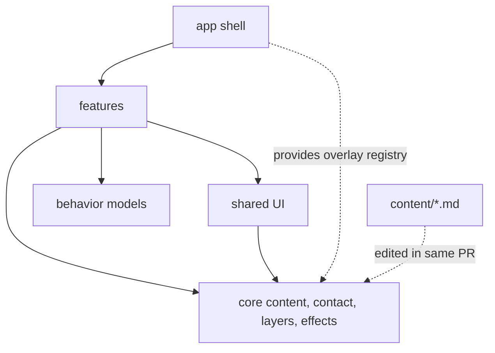
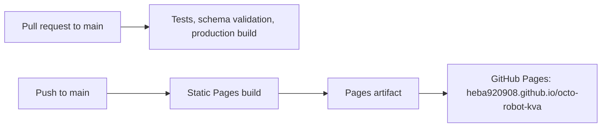

# Architecture Spine — kVA Instalaciones Landing Page

## Design Paradigm

A **feature-sliced static single-page application**: one Angular route is prerendered to static HTML and then hydrated. Dependencies flow one way.



| Layer | Location | Owns |
| --- | --- | --- |
| App shell | `src/app/app.*` | Page composition, global providers, overlay component registry |
| Features | `src/app/features/<feature>/` | Section UI and feature-local signal state |
| Shared UI | `src/app/shared/` | Reusable presentational pieces and validators |
| Core | `src/app/core/` | Executable content, schemas, contact links, layers, effects |
| Behaviors | `src/app/behaviors/` | Typed, side-effect-free behavior models |
| Editorial content | `content/` | Markdown Content docs for staff and AI assistants |

## Invariants & Rules

### AD-1 — One-way feature boundaries

- **Binds:** all application code
- **Prevents:** features coupling to each other or duplicating shared logic
- **Rule:** Features may import `shared`, `core`, and `behaviors`; they never import another feature. Shared UI never imports features. Core and behaviors never import features or shared UI. Core defines overlay IDs, overlay input types, and an `OVERLAY_COMPONENTS` injection token; only the app shell provides that token's overlay-to-feature-component map.

### AD-2 — Markdown is editorial authority, not runtime input [ADOPTED]

- **Binds:** FR-4, FR-5, FR-8, FR-9, FR-10, FR-14, FR-15, FR-17, FR-18, FR-19, FR-20, NFR-5
- **Prevents:** Markdown becoming a CMS, a parser dependency, or a hidden build pipeline
- **Rule:** `content/**/*.md` is the editorial source of truth. Angular never imports, fetches, parses, renders, or builds from it. A content PR updates the Content doc and its Executable content together, or states why no executable change is needed; review checks parity.

### AD-3 — Typed Executable content has one owner

- **Binds:** FR-1 through FR-20, NFR-5
- **Prevents:** copy spread through templates, duplicated facts, and inconsistent content shapes
- **Rule:** User-visible content lives only in readonly typed content objects under `src/app/core/content/`. Only the content facade reads raw content. It owns ordering, formatting of UI-string placeholders, published-visibility filters, client permissions, cross-reference resolution, and the visible-section list consumed by navigation and sections. Components bind to the facade and contain no literal visible text or literal `aria-label`, `alt`, `title`, or `placeholder` values. JSON Schemas in `src/app/core/schemas/` are the content contracts; unit tests validate every content object with `Ajv2020` from `ajv/dist/2020` plus `ajv-formats`. Validation code is test-only and never enters the browser bundle.

### AD-4 — Angular Material is the UI foundation [ADOPTED]

- **Binds:** all interactive and form UI, NFR-1, NFR-2
- **Prevents:** custom replicas of framework controls, competing UI libraries, and fragile styling
- **Rule:** Use Angular Material first. Use Angular CDK only where Material has no suitable control. Theme Material only through its supported theme and override APIs, fed by project tokens. Do not style private Material DOM classes or add another component library. Before adding Material packages, record their production-bundle impact against NFR-1 budgets.

### AD-5 — Central layer controller owns overlays and history [ADOPTED]

- **Binds:** FR-1, FR-2, FR-6, FR-8, FR-11, FR-12, FR-14
- **Prevents:** conflicting stacks, lost focus, and inconsistent browser Back behavior
- **Rule:** `core/layers` alone opens and closes the Mobile menu, Contact composer, Project detail view, and Privacy notice. It is the only code that calls `history.pushState`, `history.replaceState`, or `history.back`, and the only `popstate` listener; section navigation requests fragment updates through it. History operations are serialized. Features never call `MatDialog` directly. Every Material dialog uses `closeOnNavigation: false`. The only permitted stack is Privacy notice over Contact composer. Project detail to Contact composer replaces the detail entry while preserving the original card as the final focus-return target.

### AD-6 — State stays local unless shared

- **Binds:** all interactive features
- **Prevents:** global stores for local UI and persistence of personal data
- **Rule:** Feature-local state uses signals inside the feature. Cross-feature state belongs to a named core service. `core/contact` owns the in-memory Contact draft used across composer openings; no cookies, local storage, session storage, or network transmission.

### AD-7 — Behavior models govern interactions

- **Binds:** every interactive component listed in EXPERIENCE.md
- **Prevents:** UI state transitions that are untested or differ from accepted behavior
- **Rule:** Each `src/app/behaviors/<id>.behavior.ts` exports finite discriminated `State` and `Event` types and conforms to the shared `BehaviorModel<State, Event>` type in `src/app/behaviors/behavior-model.ts`. It declares `id`, `actor`, `trigger`, descriptive `preconditions`, stable BMAD acceptance IDs, and a pure deterministic `transition(state, event)` returning `{ state, effects }` or `null` for an unsupported pair. This function is the single source of transition truth; feature handlers apply only its result and MUST NOT duplicate transition logic. Runtime guards live in the state/event types and function. Effects use one closed discriminated union owned by `core/effects` with kinds `focus`, `layer`, `navigate`, `copy`, `announce`, and `scroll`; each kind has one typed payload and documented meaning defined there. The feature adapter submits non-null effects once, in returned order, and none for `null`; global/modal event ownership follows AD-5. Colocated table-driven tests call the production function; interaction tests verify the adapter applies each non-null result once and applies no effects for `null`. The model and tests merge before the story enters Act.

### AD-8 — One prerendered static route

- **Binds:** FR-1, FR-16, NFR-1, NFR-3, EXPERIENCE.md no-JavaScript states
- **Prevents:** server runtime dependencies, hydration mismatches, missing crawler content, and broken no-JavaScript paths
- **Rule:** Prerender the single route with `@angular/ssr` and `outputMode: "static"`; produce no server entry or Express runtime. Prerendered HTML is the no-JavaScript baseline. One `enhanced` signal, set after first browser render, drives JavaScript-only affordances; JavaScript-only controls start with `hidden`. Responsive collapse is CSS-only. Do not use `@defer` around search-visible content. Build-time values such as the footer year come from Executable content or build configuration, never `new Date()` during render. Head metadata and JSON-LD come from Executable content during prerender.

### AD-9 — One contact-link builder

- **Binds:** FR-11, FR-12, FR-13, FR-17, FR-20, NFR-4
- **Prevents:** inconsistent Lead tags, encoding, and phone formats
- **Rule:** A pure function in `core/contact` builds every `mailto:`, `tel:`, and WhatsApp URL from Executable content. It owns the Lead subject tag, Spanish body template, URL encoding, and conversion of stored E.164 numbers to `tel:` and `wa.me` forms. The site sends and stores no contact data.

### AD-10 — Static CSP-compatible output

- **Binds:** NFR-1, NFR-4
- **Prevents:** CSP failures and privacy leaks through inline scripts, fonts, icons, scripts, or images
- **Rule:** Self-host fonts, icons, and images. Do not use Google Fonts, icon fonts, analytics, trackers, or other runtime third-party origins. Disable critical CSS inlining and subresource integrity, and do not enable event replay, so production HTML has no executable inline scripts. JSON-LD remains a non-executable data block. On GitHub Pages, deliver CSP as a `<meta http-equiv="Content-Security-Policy">` tag: `default-src 'self'; script-src 'self'; style-src 'self' 'unsafe-inline'; img-src 'self' data:; font-src 'self'; object-src 'none'; base-uri 'self'`. Header-only `frame-ancestors 'none'` waits for a header-capable host or CDN. The build test rejects executable inline scripts.

### AD-11 — GitHub Pages delivery through Actions [ADOPTED]

- **Binds:** CI/CD, hosting, NFR-4
- **Prevents:** a parallel CI/CD system, stored deployment secrets, and broken project-site asset paths
- **Rule:** GitHub Actions is the only CI/CD orchestrator. Pull requests to `main` run unit tests, content validation, and the production build. Pushes to `main` build the static output with base href `/octo-robot-kva/` and deploy it to the `github-pages` environment using `actions/configure-pages`, `actions/upload-pages-artifact`, and `actions/deploy-pages`. The deploy job uses built-in `pages: write` and `id-token: write` permissions; no personal access token or repository secret is used. The build stays host-neutral so another static host can replace Pages later.

### AD-12 — Stable entity identifiers

- **Binds:** FR-5, FR-6, FR-7, FR-8, FR-10, FR-19
- **Prevents:** broken filters, prefills, permissions, and references when display names change
- **Rule:** Every Service, Project, Trust item, and client group has an immutable `id` equal to its Content doc slug. References use typed IDs such as `serviceId` and `clientGroupId`, never display names. Cross-feature inputs, overlay data, and filters carry IDs. Tests prove every reference resolves and IDs are unique.

### AD-13 — Framework schematics are normalized

- **Binds:** project setup, AD-4, AD-8, AD-10
- **Prevents:** generator defaults silently violating static, CSP, and theming rules
- **Rule:** After adding SSR, set `outputMode: "static"` and remove generated server or Express runtime pieces. After adding Material, remove remote font and icon links, self-host required fonts, use registered SVG icons, and replace default themes with project-token theming.

### AD-14 — One public image path

- **Binds:** FR-3, FR-8, FR-9, FR-16, NFR-1
- **Prevents:** inconsistent image sizing, loading, alternatives, and source paths
- **Rule:** Runtime images are served from `public/media/`; source originals may remain in `assets/media/`. Features render photographs only through one shared responsive-image component using Executable content metadata. Hero images are eager and high priority; other images are lazy.

## Consistency Conventions

| Concern | Convention |
| --- | --- |
| Naming | Angular 2025 file names: `hero.ts`, `hero.html`, `hero.scss`, `hero.spec.ts` |
| Content docs | `content/<type>/<slug>.md`; singleton docs use `content/<type>.md` |
| Executable content | `src/app/core/content/<type>.content.ts`; stable `id` values match Content doc slugs |
| Schemas | `src/app/core/schemas/<type>.schema.json`, JSON Schema draft 2020-12 |
| Behavior models | `src/app/behaviors/<behavior-id>.behavior.ts`, IDs from EXPERIENCE.md |
| Styling | Tokens through CSS custom properties; Material through supported APIs only |
| Browser APIs | Use `DOCUMENT` or after-render hooks; never branch rendered markup by platform |
| Errors | Content and contract failures fail tests or build; contact failures show the copy fallback |

## Stack

| Name | Version |
| --- | --- |
| Angular framework | 22.2.3, framework packages kept on the same patch |
| Angular CLI and build | 22.2.3, upgraded with framework packages |
| Angular Material | 22.2.4 |
| Angular CDK | 22.2.4, same version as Material |
| Angular SSR | 22.2.4 |
| Angular platform-server | 22.2.3, exact match with Angular core |
| TypeScript | 6.0.3, within Angular 22's `>=6.0 <6.1` range |
| Vitest | 5.0.5 |
| jsdom | 30.1.3 |
| Ajv | 8.20.0 |
| ajv-formats | 3.0.1 |

## Structural Seed

```text
content/                         # Markdown editorial source of truth
src/app/
  behaviors/                     # Typed behavior models
  core/content/                  # Typed Executable content and content facade
  core/schemas/                  # Content and design-token schemas
  core/contact/                  # Contact draft and contact-link builder
  core/effects/                  # Behavior effect runner
  core/layers/                   # Overlay and history controller
  features/<feature>/            # Header, hero, services, projects, nosotros, trust, contact, privacy, footer
  shared/                        # Shared UI and validators
src/styles/                      # Tokens and Material theme integration
public/media/                    # Runtime images and icons
```

| Brownfield file | Baseline change |
| --- | --- |
| `src/index.html` | Replace English title and language with prerendered es-MX metadata from Executable content |
| `src/app/app.ts` | Make the shell OnPush and compose features |
| `src/app/app.config.ts` | Add hydration and project providers |
| `angular.json` | Add static prerender output, CSP-compatible optimization, public media, and a Pages base href |
| `public/favicon.ico` | Replace with the kVA-derived favicon |



## Capability → Architecture Map

| Capability / Area | Lives in | Governed by |
| --- | --- | --- |
| Navigation and shell | `features/header`, app shell | AD-1, AD-5, AD-7, AD-8 |
| Hero, Services, Nosotros, Trust | Corresponding features | AD-2, AD-3, AD-4, AD-12 |
| Projects, detail, carousel | `features/projects` | AD-3, AD-4, AD-5, AD-7, AD-12, AD-14 |
| Contact composer and links | `features/contact`, `core/contact` | AD-5, AD-6, AD-9 |
| Privacy notice | `features/privacy`, `core/layers` | AD-3, AD-5, AD-8 |
| Footer | `features/footer` | AD-3, AD-8, AD-9 |
| Content management | `content/`, `core/content`, `core/schemas` | AD-2, AD-3, AD-12 |
| SEO and sharing | App shell, `core/content` | AD-3, AD-8, AD-14 |
| Performance, accessibility, privacy | All layers | AD-4, AD-6, AD-8, AD-10, AD-14 |

## Deferred

| Item | Reason |
| --- | --- |
| Alternative production host or CDN | GitHub Pages is the initial host; revisit if header-only security is required |
| Header-only protections: `frame-ancestors`, HSTS policy, Referrer-Policy, Permissions-Policy, X-Content-Type-Options | GitHub Pages cannot set custom response headers |
| Lighthouse automation | Can run after the first Pages deployment exists |
| Image derivative tooling | AD-14 fixes the runtime contract; generation is owned by Epic 1 Story 1.4 |
